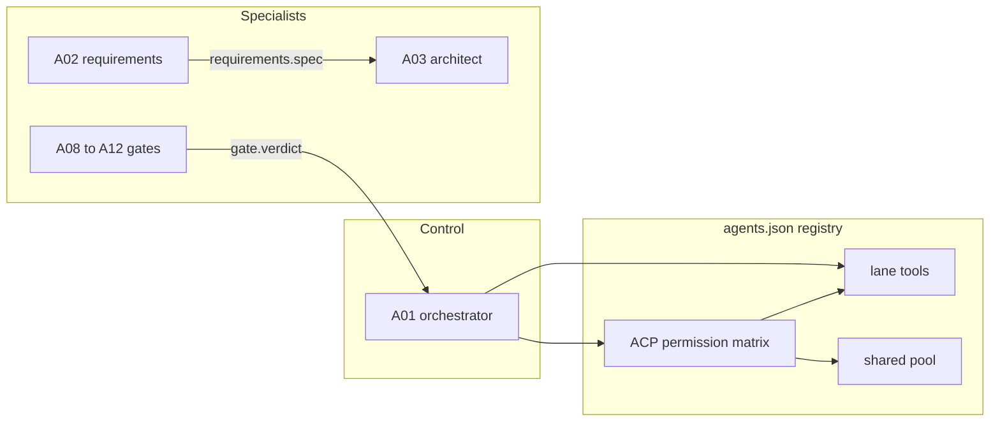
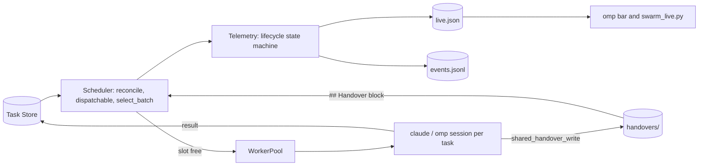

# Architecture overview

AgentSwarm is a 15-agent software-delivery loop. A01 owns the plan. The other agents do one lane each (requirements, architecture, UX, backend, frontend, data, test, review, security, devops, release, observability, maintenance, docs). This page is the map of the layers added in v2.1 (registry, shared pool, ACP) and v2.2 (continuous runtime, telemetry, handover, skills, the omp bar). Agent prompts and lane scripts are unchanged.

## Topology

End-to-end trace for one feature:

1. A01 decomposes the brief. `orch_dag_order` orders the task graph. `orch_budget_class` returns the risk budget the planner already uses.
2. A02 checks acceptance text with `req_gwt_check` and may call `shared_verdict` on the finding severities.
3. A03 and A04 publish contracts and tokens. A05 and A06 implement against them and share `shared_toolchain` / `shared_check_plan` (the old `code_checks.py` pair).
4. A08–A12 gates call `shared_verdict`. A denial is UNAUTHORIZED plus an audit row. A passing gate is a `gate.verdict` message A01 already consumes.
5. A11 records the git head with `shared_git_head`. A12 builds the canary steps. A13 computes burn. A peer that never answers is retried, then dead-lettered, and a sick peer is circuit-broken. The caller's own lane tools keep running.

## Tool layer

`agents.json` is the only registry (`tool_contract: swarm.tool.v1`). Each agent has `registered_tools` (10 to 15, set by `capability_policy`). Cross-lane operations live in top-level `shared_tools`; `shared_baseline` names the ones all 15 agents may call. `python3 -m swarm.tool_registry call` and, for omp sessions, `swarm_catalog` / `swarm_tool_call` (through `scripts/swarm_tool.py`) are the only paths that import a handler. An unknown name returns `INVALID_INPUT` and does not import anything. Existing `scripts/*.py` entrypoints still run as they did in v2.0. New tools arrive as `registry/intake/` fragments merged by `scripts/_registry_intake.py`, never by hand edits.

Every registered tool ends in exactly one of: SUCCESS, INVALID_INPUT (names the field), UNAUTHORIZED (echoes the caller), DEPENDENCY_UNAVAILABLE, TIMEOUT, or PARTIAL_SUCCESS (includes `completed_fraction`). Two registry guards apply to every tool: a `number` input must be finite (NaN and Infinity are `INVALID_INPUT`), and a result must be strict JSON and at most `SWARM_TOOL_OUTPUT_MAX_BYTES` (default 262144); a larger one is withheld as `PARTIAL_SUCCESS` with `output_withheld: true`.

## Shared pool

The pool is the set of functions two or more lanes already called, plus the v2.2 baseline every agent has: 13 handover tools, 8 runtime tools and the four original ones (`shared_verdict`, `shared_toolchain`, `shared_check_plan`, `shared_git_head`). The baseline and its call path are described in [swarm-command-center.md](swarm-command-center.md).

## ACP fabric

Agents exchange `acp.v1` envelopes through `swarm/acp.py`. The in-process transport derives endpoints (`inproc://A03`) and the allow list from each agent's `produces` and `consumes`. There is no peer list in code. Default is deny. The signed `swarm.v1` task-store envelopes are a different channel and are not replaced by ACP.

## Runtime (v2.2)

`scripts/swarm_run.py` no longer runs in rounds. A persistent worker pool is refilled the moment a session finishes, bounded by `--max-parallel` (default 4, ceiling 32) and each agent's own `max_parallel`. `SWARM_SCHEDULER=rounds` restores the per-round barrier.

Data flow of one task: `reconcile()` and `dispatchable()` find ready tasks; `select_batch()` applies the global cap, the per-agent ceilings and `notes.claims`; the task becomes a run (`queued`, `starting`, `running`, then `completed`, `failed`, `cancelled` or `timed_out`) whose every transition is a `swarm.run.*` event and a row in `live.json`. The session receives a signed `task.assign` plus the latest handover of each dependency; it calls registry tools through `swarm_tool_call`, writes its own handover (filed under its own task id, addressed with `to_agent`), and ends with a `task.result` whose `.md` evidence the runner redacts before writing it. A transient failure waits `notes.retry_after` (capped exponential backoff); an isolated failure never lowers the parallelism, but a provider rate limit, or `SWARM_FAIL_STREAK` (default 3) consecutive failures of distinct tasks, halves the effective parallelism (AIMD) and is reported as `swarm.degraded`. SIGINT, SIGTERM, SIGHUP or `--swarm-timeout` start a cooperative cancel (`cancel/<correlation_id>` flag, grace, then the process-group kill).

| Module | Role |
| --- | --- |
| `swarm/lifecycle.py`, `swarm/clock.py` | Run state machine; monotonic clock and `format_elapsed` |
| `swarm/telemetry.py`, `swarm/redact.py` | One telemetry channel (`events.jsonl` + `live.json`), redaction of every payload |
| `swarm/claims.py`, `swarm/retry.py`, `swarm/limiter.py` | File claims, backoff and transient classifier, AIMD limiter |
| `swarm/subagent_lifecycle.py` | Global slot cap and overdue watchdog |
| `swarm/handover.py`, `swarm/tools/shared_handover.py`, `swarm/tools/shared_runtime.py` | `swarm.handover.v1` and the shared baseline tools |
| `swarm/skill_registry.py` | Validates and documents `prompts/skills/` |
| `omp/src/swarm_bar.ts` | The third bar ([swarm-bar.md](swarm-bar.md)): merges the omp bus, `live.json` (an idle `stat` watcher every `SWARM_BAR_IDLE_POLL_MS`) and the specialists A01 spawns in-session (`inflightTaskDetails`) |

## Where to read next

- The v2.2 runtime, telemetry, handover, skills, how-to guides, configuration and known limits: [swarm-command-center.md](swarm-command-center.md)
- Reading the third bar: [swarm-bar.md](swarm-bar.md)
- Tool catalog and the 15 registry pages: `docs/tools/`; skill catalog: `docs/skills/`
- Envelope, retries, and two worked messages: `docs/acp-topology.md`
- How to add a tool or skill, regenerate, cancel a run or diagnose a dead peer: `docs/operations-runbook.md`
