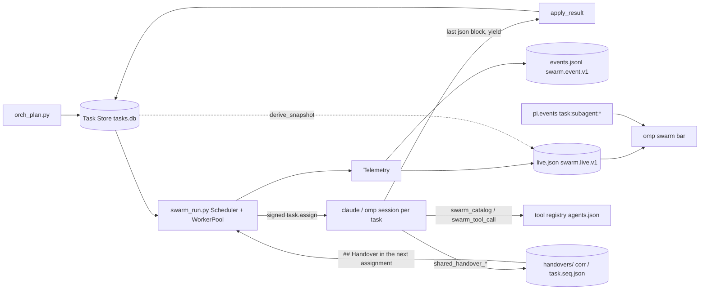

# Swarm Command Center (v2.2)

v2.2 turns the swarm from a round-by-round runner into a bounded, observable, continuously scheduled runtime. Every
agent gets a shared baseline of tools and skills plus its own, a versioned handover document passes work between
agents, one telemetry channel feeds the logs and the UI, and the omp swarm bar (always mounted, topmost above the editor)
shows every subagent's state and elapsed time and the session's token savings. Nothing here changes the Task Store state machine, the signed envelopes, the gates or the classifier: the new
runtime state is a projection over them.

Each statement below was checked against the code and, where it names a command, run in a scratch copy with a
temporary `SWARM_DIR`. Section 13 lists the known limits, and why.

v2.3 grows the roster from 15 to 30 agents (A16 to A30) on the same runtime. The counts below are the 30-agent
state; section 9.1 is the checklist for adding an agent and section 16 lists what v2.3 changed.

## 1. Architecture



| Concern | Module | Notes |
|---|---|---|
| Run state machine | `swarm/lifecycle.py` | `RunState`, `RunEvent`, `next_state`, `from_task_state` |
| Time | `swarm/clock.py` | `Clock`, `FakeClock`, `format_elapsed`; durations are monotonic differences |
| Redaction | `swarm/redact.py` | applied by `runlog.emit` to every payload |
| Telemetry | `swarm/telemetry.py` | `Telemetry` producer, `derive_snapshot`/`refresh_live` stateless path, `read_live` |
| Viewer | `scripts/swarm_live.py` (+ `scripts/ts/swarm_live.ts`) | table or JSON of `live.json` |
| Scheduler | `scripts/swarm_run.py` | `Scheduler`, `WorkerPool`, `RunBook`, `CancelRequest`, `select_batch` |
| Lifecycle manager | `swarm/subagent_lifecycle.py` | global slot cap, overdue watchdog |
| Primitives | `swarm/claims.py`, `swarm/retry.py`, `swarm/limiter.py` | file claims, backoff and classifier, AIMD limiter |
| Handover | `swarm/handover.py`, `swarm/tools/shared_handover.py` | `swarm.handover.v1` |
| Shared runtime tools | `swarm/tools/shared_runtime.py` | status, scratchpad, escalate, cancel check, log, route check |
| Registry and call path | `swarm/tool_registry.py`, `scripts/swarm_tool.py`, `omp/src/tools.ts` | `swarm_catalog`, `swarm_tool_call` |
| Skills | `swarm/skill_registry.py`, `scripts/_write_skills.py`, `scripts/build_agents.py` | sources in `prompts/skills/` |
| Intake | `scripts/_registry_intake.py`, `registry/intake/` | serialized merge into `agents.json` |
| Bar | `omp/src/swarm_bar.ts` | see [docs/swarm-bar.md](swarm-bar.md) |

## 2. Runtime lifecycle

A run is one attempt of one task. `run_id = "<task_id>.a<attempt>"`. A retry is a new run, so terminal states have no
exits.

States: `waiting`, `queued`, `starting`, `running`, `handing_off`, and the terminal `completed`, `failed`,
`cancelled`, `timed_out`. `stalled` is not a state: it is `running` with no activity for longer than
`SWARM_STALL_AFTER_S`.

| From | Event | To |
|---|---|---|
| waiting (dependency) | `deps_satisfied` | queued |
| waiting (input) | `input_received` | running |
| queued | `slot_acquired` | starting |
| starting | `process_started` | running |
| running | `await_input` / `begin_handoff` / `finish_ok` / `finish_error` | waiting (input) / handing_off / completed / failed |
| handing_off | `handoff_done` / `finish_error` | completed / failed |
| any non-terminal | `cancel` / `deadline_exceeded` | cancelled / timed_out |

`finish_error` is also legal from `waiting` (a dependency failed) and `starting`. An illegal event raises
`SwarmError(E-CONTRACT)` naming the state, the event and the allowed events. `from_task_state` maps a Task Store
state onto a run state (`CLAIMED` to starting, `IN_PROGRESS` to running, `IN_REVIEW`/`APPROVED`/`DONE` to
completed, `FAILED`/`ESCALATED` to failed, `BLOCKED` to waiting).

As shipped, the scheduler drives `queued` to `starting` to `running` to a terminal state and marks tasks whose
dependencies are open as `waiting`. `await_input` and `begin_handoff` are in the table and accepted by
`Telemetry.transition`, but the scheduler does not emit them: a handover is recorded as the
`swarm.run.handover` event, not as a `handing_off` phase.

## 3. Telemetry channel

One channel, two sinks, both written by `swarm.telemetry.Telemetry`.

**`<swarm_dir>/events.jsonl`** (schema `swarm/schemas/swarm.event.v1.json`). Records are
`{ts, type, source, correlation_id, task_id, payload, msg_id}`; every payload passes `swarm.redact`.

| Type | Payload |
|---|---|
| `swarm.run.queued` | run_id, agent, attempt, priority, deps, queue_depth |
| `swarm.run.started` | run_id, agent, attempt, sid, runtime, started_wall, deadline_wall, budget_max_wall_s |
| `swarm.run.state` | run_id, agent, from, to, event, reason, wait_kind |
| `swarm.run.activity` | run_id, agent, tool, text, tool_calls, turns, tokens (at most one per second per run; local only, never sent to the substrate) |
| `swarm.run.heartbeat` | run_id, agent, state, elapsed_s, state_elapsed_s, since_activity_s, stalled, tool_calls, last_tool, activity (local only) |
| `swarm.run.stalled` | run_id, agent, since_activity_s, threshold_s (once per stall episode) |
| `swarm.run.finished` | run_id, agent, state, outcome (the final run state: `completed`, `failed`, `cancelled` or `timed_out`), duration_s, error_code, error |
| `swarm.run.handover` | run_id, from_agent, to_agent, handover_id, digest, bytes, summarized |
| `swarm.scheduler.tick` | round, ready, running, queued, waiting, free_slots, max_parallel, effective_parallel, per_agent, skipped |
| `swarm.degraded` | reason, mode, detail (modes seen: `reduced_parallelism`, `cancelling`, `recovered`; reasons include `rate_limited` and `consecutive_failures`) |
| `swarm.tool.call` | tool, caller, state, duration_ms, error_state? (written by the registry, local only, only when the state dir exists or the tool is WRITE tier, section 7) |

**`<swarm_dir>/live.json`** (schema `swarm/schemas/swarm.live.v1.json`): the current picture, rewritten atomically
(temp file plus `os.replace`, at most once per second unless forced).

```json
{"schema":"swarm.live.v1","producer":"scheduler","correlation_id":"...","seq":16,"updated_wall":1792379841.77,
 "swarm":{"state":"completed","elapsed_s":2.25,"max_parallel":4,"effective_parallel":4,"running":0,"queued":0,
          "waiting":0,"completed":13,"failed":0,"cancelled":0,"timed_out":0,"stalled":0,"degraded":null},
 "runs":[{"run_id":"T1d63-be.a1","task_id":"T1d63-be","agent":"a05-backend","state":"completed","attempt":1,
          "elapsed_s":0.2,"state_elapsed_s":0.2,"since_activity_s":null,"stalled":false,"activity":null,
          "tool_calls":0,"last_tool":null,"parent":null,"handover_in":null,"handover_out":null,"error":null}]}
```

- `elapsed_s` values are producer-monotonic as of `updated_wall`. A reader in another process extrapolates with its
  own monotonic clock; it never subtracts wall clocks. `runs` holds at most 64 entries (failed, timed-out, stalled
  and running first). Strings are redacted and clipped.
- `producer` is `scheduler` (a running `swarm_run.py`; activity-rich) or `derived` (rebuilt from the Task Store and the
  tail of `events.jsonl` by `derive_snapshot`). `TaskStore.transition` calls `refresh_live` after a committed
  transition, so an in-session run (A01 driving `orch_status.py` through `swarm_transition`/`swarm_ingest`, no
  scheduler process) feeds the same file. A derived writer never replaces a fresh scheduler document whose pid is
  alive.
- A snapshot older than three heartbeats (`3 x SWARM_HEARTBEAT_S`) is stale. `scripts/swarm_live.py` then derives the
  view instead; the bar shows `live.json stale`.

Telemetry is a display projection: a failure inside it is logged and never changes a dispatch (`_safe` in
`swarm_run.py`). Events are also sent to the substrate when it is configured and the run is not `--dry-run`
(`Telemetry(tee=not dry_run)`).

Read it:

```bash
python3 scripts/swarm_live.py                    # table for the latest correlation
python3 scripts/swarm_live.py --json             # {"source": "live.json" | "task-store", "live": <swarm.live.v1>}
python3 scripts/swarm_live.py --watch 2          # redraw every 2 s
python3 scripts/swarm_live.py --correlation-id <id> --root /path/to/repo
```

## 4. Continuous scheduler

`scripts/swarm_run.py` keeps a persistent pool of daemon worker threads (`WorkerPool`) and refills a slot the moment a
session finishes. After every completion it runs `reconcile()`, `dispatchable()` and `select_batch()` again, so one
slow task never holds back newly ready work.

- **Order:** priority (P0 first), DAG depth, creation time (`order_ready`).
- **Caps:** the global cap is `--max-parallel`, else `SWARM_MAX_PARALLEL`, else 4, never above
  `SWARM_MAX_PARALLEL_CEILING` (32). Each agent's `max_parallel` in `agents.json` applies on top; a class at its
  ceiling does not block another class from taking a free slot. The old fixed cap of 4 (`HARD_MAX`) is gone.
- **Budget:** `--max-rounds` (default 50) bounds dispatches to `max-rounds x max-parallel`, as a total: one pass starts at
  most what is left of it, so freed slots never carry a run past the budget.
- **File claims:** a task whose `notes.claims` overlap a claim held by a running task waits
  (`claim-conflict:<holder>` in the tick's `skipped`). Items are a pattern string (exclusive) or
  `{"pattern": "docs/*.md", "mode": "shared"}`. Patterns are repo-relative globs; absolute paths and `..` are
  rejected and a malformed claim moves the task to BLOCKED instead of running it unclaimed. End a directory claim
  with `/` (`src/api/`): a bare `src/api` does not reliably cover the files below it. `orch_plan.py` does not write
  claims; set them before the run:
  `python3 -c "from swarm.taskstore import TaskStore; TaskStore().set_notes('<task_id>', claims=['src/api/'])"`
  (with `SWARM_DIR` set).
- **Backpressure (AIMD):** a provider rate limit (429, "rate limit", "overloaded", `Retry-After`) halves the effective
  parallelism once per burst, emits `swarm.degraded` (`reduced_parallelism`), and one slot is added back per success
  after `SWARM_RATE_COOLDOWN_S`.
- **Failure isolation and circuit:** one failed task never lowers the parallelism; it follows the retry and
  escalation ladder and its siblings keep running at the current effective parallelism. Systemic trouble is caught by a
  circuit: `SWARM_FAIL_STREAK` (default 3, `0` disables) consecutive non-rate-limit failures of distinct tasks with no
  success in between halve the effective parallelism once per streak (floor 1) through the same AIMD limiter, emitting
  `swarm.degraded` (`reason: consecutive_failures`, `mode: reduced_parallelism`, `detail: "<n> failures in a row;
  effective_parallel a -> b"`). A success resets the streak, and successes add the slots back (after
  `SWARM_RATE_COOLDOWN_S`) and clear the marker when the cap is whole again. A rate-limited failure neither counts nor
  resets the streak, and failures while a cancel is in progress are not counted. `ErrorHandler` keeps its API but the
  runner no longer latches its sequential mode for an ordinary failure.
- **Retry:** a transient failure (E-TIMEOUT, E-DEP, E-CAPACITY, or a rate-limit marker; never E-INPUT, E-POLICY or
  E-CONTRACT) writes `notes.retry_after` (an epoch wall time) = `now + backoff_s(attempt)`, capped exponential
  (`SWARM_RETRY_BASE_S`, `SWARM_RETRY_CAP_S`, plus or minus 25 % jitter; a provider `Retry-After` can lengthen it up
  to the cap). The task is skipped (`backoff:<s>` in `skipped`) until then and the loop sleeps to the earliest
  retry. Attempts stop at the task's `max_attempts`.
- **Isolation:** a worker exception fails only that task (E-INTERNAL); a task whose worker raised three times is left
  alone for the rest of the run (`internal-failure`).
- **Result evidence:** the agent's `.md` result (`results/<task>.a<N>.md`) is passed through `swarm.redact.redact_text`
  before it is written, like every run-log payload, so a token an agent echoed never reaches the disk. The structured
  `.findings.json` is a machine input of the gate scripts and is written as given.
- **Stranded work:** at start (not on `--dry-run`), a task left `IN_PROGRESS` by a dead runner past
  `notes.running_deadline` is failed `E-TIMEOUT: stranded` and retried.
- **Heartbeats and stall:** a monitor thread writes `live.json` at 1 Hz, beats every `SWARM_HEARTBEAT_S`, and flags a
  silent omp stream after `SWARM_STALL_AFTER_S`. claude and grok report elapsed time only, so the monitor pings
  them and they never read as stalled.
- **Timeouts:** `--task-timeout` (default 1800 s) per session: the runner kills the session's process group
  (SIGTERM, then SIGKILL after 10 s), keeps the partial output and fails the task E-TIMEOUT. `--swarm-timeout <s>`
  (default 0, off) cancels the whole run like a signal.
- **Cancel:** SIGINT, SIGTERM, SIGHUP or `--swarm-timeout` write `<swarm_dir>/cancel/<correlation_id>`
  (`{requested_wall, reason, grace_s}`), dispatch nothing new, wait for sessions to leave on their own, then kill their
  process groups (a second signal skips the wait). Sessions see the flag through `shared_cancel_check`; the path rule is
  `cancel_flag_path` in `swarm.tools.shared_runtime`, imported by both the writer (`swarm_run.py`) and the reader tool, so
  they cannot drift. The whole
  shutdown fits in `SWARM_SHUTDOWN_BUDGET_S` (default 15; `hooks/autonomous_run.py` exports its
  `SWARM_AUTONOMOUS_RUN_GRACE_S` there). The kill needs about 8 s (5 s SIGTERM-to-SIGKILL plus 3 s settle), so with
  the defaults the cooperative wait is capped at 7 s, not `SWARM_CANCEL_GRACE_S` = 10 (the log line says
  `capped`). Set `SWARM_SHUTDOWN_BUDGET_S` to at least `SWARM_CANCEL_GRACE_S + 8` for the full wait. The runner exits
  `128 + signal`.
- **Fallback:** `SWARM_SCHEDULER=rounds` restores the per-round barrier (`barrier=True`: one pass, wait for every
  session of the round, pass again, at most `--max-rounds` rounds). Everything else (telemetry, cancel, claims,
  backoff) still applies. A value other than `continuous` or `rounds` exits 2 with E-INPUT before anything is claimed.

`swarm_run.py --json` reports `scheduler`, `max_parallel`, `effective_parallel`, `rounds`, `counts` and `cancelled`.

## 5. Handover protocol

A handover is the document one agent leaves for the next. It must be enough to continue from the document alone.
`swarm.handover.v1` (`swarm/schemas/handover.v1.json`, code in `swarm/handover.py`):

`schema_version`, `handover_id` (`<task_id>.<seq>`), `correlation_id`, `task_id`, `from_agent`, `to_agent` (agent ids
such as `A05`, never slugs), `created_wall`, `goal`, `completed[]`, `remaining[]`, `decisions[{decision, rationale}]`,
`artifacts[{kind, uri, digest, producer}]`, `open_questions[]`, `blockers[]`, `constraints[]`,
`verification{status: verified|partial|unverified, confidence 0..1, checks[]}`, `summarized`, `bytes`, `digest`.

- **Storage:** `<swarm_dir>/handovers/<correlation_id>/<task_id>.<seq>.json`, canonical JSON. The writer builds the
  complete document for a candidate `seq`, writes it to a temp file in the same folder (`.<name>.<pid>.<random>.tmp`)
  and publishes it with `os.link` (exclusive and atomic): the final name never exists empty, a taken `seq` fails with
  FileExistsError and the next one is tried, so concurrent writers never collide and a writer that dies leaves no gap
  in the `seq` numbers. Readers and the scan ignore stray temp files, which are never reclaimed (age is not ownership).
  Only on a file system without hard links is the file created with `O_EXCL` and written in place; there a crash can
  leave a partial file at its `seq` (read as `malformed`, never skipped). The newest handover is the highest `seq`
  inside the task's correlation. Writing a document identical in content to the task's newest handover stores nothing
  new and returns `duplicate: true`; a changed document gets a new `seq`. The duplicate check reads the newest file
  before the seq is published, so two writers that submit the same document at the same instant both pass it and both
  are stored (two seqs, same content): the history is append-only and a repeated entry is harmless, so this is intended
  and not guarded by a lock. Ids are matched whole (a trailing newline is refused) and
  the size cap is never above the 1 MiB read limit, whatever `SWARM_HANDOVER_MAX_BYTES` says.
- **Integrity:** `digest` is the sha256 of the canonical document without its own `digest`. Read recomputes it, so an
  edited file is rejected (`malformed`).
- **Size:** at most `SWARM_HANDOVER_MAX_BYTES` (16384). A larger document is summarized deterministically, with no
  model: `completed`, `decisions` and `artifacts` shrink first; `goal`, `remaining`, `blockers`, `open_questions` and
  `constraints` are never dropped. If those alone exceed the cap, the write is refused.
- **Redaction:** free text is redacted before the digest is computed.
- **Status** (`handover_status`): `ok`, `missing`, `partial` (no remaining work, no artifacts, unverified),
  `stale` (older than `SWARM_HANDOVER_STALE_S`, 21600, or written under another correlation than the task's plan),
  `malformed`.
- **Receipts:** `<task_id>.receipt.<agent>.<digest16>.json`; the key is task, receiver and digest, the first receipt
  wins and a repeat returns it with `duplicate: true`. Only the agent the handover is addressed to (`to_agent`) can
  write it.

**Whose task id.** A handover is filed under the task id it describes, which is the producer's task. In the call
`shared_handover_write {task_id, to_agent, goal, ...}` the `task_id` is the task the writing agent is working in, and
`from_agent` is always the authenticated caller (a payload that names someone else is refused). Every reader names that
same producer `task_id`:

- the runner does it for you: each assignment carries a `## Handover` block built from `inspect_handover(dependency,
  to_agent=<the task's agent>)`, the same selection and ok/partial gate the shared tools apply (the dependency's own
  plan, the handover addressed to the receiving agent, else the newest one as context; never a handover of an older
  plan; goal, remaining, blockers, open questions, constraints, artifacts and verification;
  1200 characters per dependency, 4000 in total; missing, malformed or stale handovers are skipped, a handover is
  context and never gates a dispatch);
- `shared_handover_read`, `_verify` and `_receipt` with the producer's `task_id` read, judge and acknowledge it
  (checked in a scratch run: A05 wrote under its own task `T1d63-be` for A08; `verify {task_id: T1d63-be}` returned
  `ok`/`ready`, a receipt with the same task id succeeded, a receipt naming A08's own task id failed with
  `no valid handover of task ... has digest`);
- `shared_handover_verify` and `_bundle` with the receiver's own task id judge a handover filed under that id (rework,
  pause and escalation reuse the same task); for a fresh dependent task that is `missing`, and `bundle` still returns
  the goal, acceptance criteria and `upstream[]` (state, satisfied, summary, needs) of its dependencies.

Tools (all callable by all 30 agents): `shared_handover_write`, `_read`, `_validate` (`draft: true` fills the generated
fields), `_bundle`, `_verify`, `_receipt`, `shared_artifact_digest`, `_check`, `shared_dod_check`,
`shared_open_findings`, `shared_attempt_history`, `shared_lease_state`, `shared_open_questions`. Procedures:
`swarm-handover-emit` and `swarm-handover-intake` (autoloaded by every omp agent).

## 6. Shared baseline

`agents.json` `shared_baseline` lists the shared tools and skills every agent has. It is validated: each listed tool
must be a shared tool all 30 agents may call, each listed skill must have a source in `prompts/skills/shared/`.

- **Handover tools (13):** the list in section 5.
- **Runtime tools (8):** `shared_status_report` (latest progress of the caller's own task; emits
  `swarm.run.activity` and writes `status/<task_id>.json`, which the scheduler's `Telemetry` reads for its running
  runs, re-parsing only when the file changed: the newest of the report and the last tool call becomes the run's
  `activity` in `live.json` and a report ends a stall episode; a derived refresh may not replace a live scheduler's
  file, so the file is the channel), `shared_scratchpad_put` / `_get` (bounded per-correlation key/value store with
  compare-and-swap, under `scratch/<correlation_id>/`), `shared_escalate` (records `escalation.request` and returns a
  BLOCKED `task.result` patch), `shared_cancel_check` (the cancel flag and deadline arithmetic),
  `shared_log_emit` (one `agent.log` event), `shared_route_check` (does ACP allow this message type between two
  agents), `shared_escalation_owner`.
- **Older shared tools (4):** `shared_verdict`, `shared_toolchain`, `shared_check_plan`, `shared_git_head`.
- **Shared skills (12, hidden):** `swarm-handover-intake`, `swarm-handover-emit`, `swarm-cooperative-cancel`,
  `swarm-dod-evidence`, `swarm-escalation-takeover`, `swarm-lease-discipline`, `swarm-open-questions`,
  `swarm-provenance-trust`, `swarm-rework-intake`, `swarm-scratchpad-protocol`, `swarm-self-verify`,
  `swarm-status-reporting`.

Each agent also has its own tools (`registered_tools`, 12 to 13 per agent: 12 for 21 agents, 13 for A15, A19, A22, A23 and A26 to A30) and its own hidden skills (`prompts/skills/<slug>/`, 10 to 14 per agent). The counts are data: `agents.json` `capability_policy`
(`tools`/`skills` `min` and `max`, optionally `combined`; `enforce` defaults to true). Today it reads 10 to 15 for
both. `python3 -m swarm.tool_registry check` and `python3 -m swarm.skill_registry check` enforce it.

## 7. Call path: `swarm_catalog` and `swarm_tool_call`

Prompt bodies keep their hand-written tool inventory (omp agents are capped at 64 KiB and A01, the largest, renders at about 59.1 KiB), so
new tools and skills are discovered, not listed in prompts.

```
omp session (agent slug)           omp/src/tools.ts            scripts/swarm_tool.py            swarm/tool_registry.py
swarm_catalog {kind?, query?}  ->  --caller=<session agent> -> catalog(...)                  (tools the caller may call
swarm_tool_call {name, input}  ->  call --name --input     -> call_tool(name, caller, input)  plus own + shared skills)
```

- The caller is always the session's own agent identity, never a model parameter. A session without a swarm identity
  gets E-POLICY. The input is capped at 100 000 bytes and must be an object.
- `call_tool` is the only path that imports a handler. In order: unknown name (INVALID_INPUT), caller not in
  `permitted_callers` (UNAUTHORIZED), input validated against the tool's `input_schema` (INVALID_INPUT naming the
  field; a `number` field refuses NaN and Infinity with `expected a finite number`, because every bound comparison is
  false for them and a handler written for finite input would fail open), handler run with a `timeout_s` bound (TIMEOUT,
  DEPENDENCY_UNAVAILABLE), `SUCCESS` output validated against `output_schema`, then the output gate. The result object
  is returned verbatim; `state` is SUCCESS, INVALID_INPUT, UNAUTHORIZED, DEPENDENCY_UNAVAILABLE, TIMEOUT or
  PARTIAL_SUCCESS.
- **Output gate.** Every result must be strict JSON (no NaN or Infinity): otherwise the call is
  `DEPENDENCY_UNAVAILABLE` (`handler result is not strict JSON`). It must also serialise to at most `output_limit()` bytes,
  `SWARM_TOOL_OUTPUT_MAX_BYTES` (default 262144, clamped to 4096..16777216, a malformed value means the default). A larger
  result is withheld, not truncated (a half result is worse than none for a gate or a handover): the call becomes
  `PARTIAL_SUCCESS` with `completed_fraction: 0.0`, `output_withheld: true`, `output_bytes`, `limit_bytes` and a
  `message` telling the caller to narrow its input.
- In omp plan mode `swarm_tool_call` passes `--plan-mode`, and Python refuses any tool above READ with E-POLICY before
  the handler is imported. `swarm_catalog` always works.
- Outside omp: `python3 scripts/swarm_tool.py catalog --caller A05 --kind tools --query route` and
  `python3 scripts/swarm_tool.py call --caller A05 --name be_route_norm --input '{"path": "/users/:id/"}'`;
  `python3 -m swarm.tool_registry call --name <tool> --caller <A05> --input '<json>'` is the registry-level twin.
- Audit: a `call_tool` appends one local-only `swarm.tool.call` row (`source: registry`) with `tool`, `caller`,
  `state`, `duration_ms` (and `error_state` when not successful), plus the run's correlation and task ids when known.
  The row is written when the swarm state dir already exists or the tool is WRITE tier: a READ call through
  `python3 -m swarm.tool_registry call` in a workspace without `.swarm` writes nothing and never creates the directory
  (`scripts/swarm_tool.py` is an AgentScript and writes its own `script.swarm_tool` run-log row, which does create it).
  It never contains a payload value, is never sent to the substrate, and a failure to write it never changes the
  result.

## 8. Skill system

- **Sources:** `prompts/skills/<owner>/<short>.md`, where `<owner>` is an agent slug or `shared`.
- **Rendering:** each source becomes a hidden, flat skill `omp/skills/<name>/SKILL.md` with
  `disable-model-invocation: true`; omp lists it only through a `skill://<name>` link. Only the 30 per-agent index
  skills (`omp/skills/<slug>/`) and `swarm-orchestrate` are visible, 31 in all: `tests/test_capability_acceptance.py`
  computes the cap as the agent count plus one (`MAX_VISIBLE_OMP_SKILLS = len(AGENTS) + 1`), so it grows with the roster.
- **Index skill:** generated per agent with its `registered_tools` (name, tier, purpose) and its skills
  (`skill://<name>` plus the description).
- **Autoload:** every omp agent autoloads its index skill and `swarm-handover-intake`, `swarm-handover-emit`; A01 also
  autoloads `swarm-orchestrate`. `build_agents.py` refuses an autoload name with no generated skill (omp drops
  unknown names silently).
- **Generation:** `python3 scripts/build_agents.py` writes `omp/skills/**`; `python3 scripts/_write_skills.py` writes
  `skills/**` and `omp/skills/**` and validates the sources first (it writes nothing on an error; it does not check
  counts). `python3 -m swarm.skill_registry docs` writes `docs/skills/**`.

## 9. How to

### 9.1 Add a subagent

The roster is data in `agents.json`, but several places list the agents by id and several tests pin the count, so a new
agent is a deliberate change across all of the places below, not a config edit. v2.3 took the swarm from 15 to 30 agents
(A16 to A30) through this list. Grep for `range(1, 31)`, `== 30` and `A30` to find a place a thirty-first agent would
miss (a count that is only a number in a test is listed in step 8).

1. **Spec and prompt.** `03-agents/A31-<name>.md`: the seven-section spec. `prompts/A31-<name>.md`: the XML prompt with
   `<agent id="A31"`, the 20 tag pairs listed in `AGENTS.md` (Testing & QA), `<script path=`, `python3 scripts/` and
   `scripts/ts/`, ending with `</agent>`. Size: keep the prompt body to about 52 KB. `prompts/A01-orchestrator.md` is the
   largest prompt at 52781 bytes and its omp render, `omp/agents/a01-orchestrator.md`, 60569 bytes; every
   omp agent file must stay at or under `OMP_AGENT_MAX_BYTES` (64 KiB) and `a01-orchestrator` must remain the largest
   (`test_omp_size_bound` in `tests/test_omp_agents.py`, `test_omp_agent_files_fit_and_the_orchestrator_is_largest` in
   `tests/test_capability_acceptance.py`). The omp render adds a preamble to the prompt, so a body near A01's size would
   overtake it.
2. **Roster entry.** `agents.json`, in `agents`: `id`, `code`, `slug`, `name`, `class` (`control`, `delivery`, `build`,
   `verify`, `operate` or `sustain`), `lane`, `model` (optional: only A01, A03, A09, A10 and A15 set it), `spec`, `prompt`,
   `description`, `capabilities` (use ids no other agent offers: `orch_plan.py` and `blast_radius.py` take the first agent
   that offers a capability, and `code.patch`, offered by A05 and A06, is the one shared id), `consumes`, `produces`, `max_parallel`, `autonomy_ceiling` (capability to `L2`..`L4`),
   `tools`, `scripts`, `registered_tools`. Nobody hand-edits `registered_tools`: use the intake flow of 9.2. If the new
   agent produces an artifact type that an existing agent takes, add it to that agent's `consumes`: the ACP routing
   table and `shared_route_check` derive from `consumes` and `produces` and there is no peer list.
3. **Code that lists the agents.**
   - `PREFIX` in `swarm/tool_registry.py`: the owner prefix of the agent's tool names.
   - `AGENT_SURFACES` in `swarm/substrate_tee.py` (`swarm-<id>-<code>`, lower case) and `SWARM_SURFACES` in
     `swarm/memory.py`; `tests/test_substrate_tee.py` and `tests/test_swarm_memory.py` pin them against `agents.json` and
     each other. The surface must also exist on the agent-substrate server, and a workspace install with substrate tokens
     needs `SUBSTRATE_TOKEN_<SURFACE>` for it ([substrate-workspace.md](substrate-workspace.md)).
   - `SWARM_SLUGS` in `omp/src/guard.ts` (pinned against `agents.json` by `omp/test/guard.test.ts`).
   - In `scripts/build_agents.py`: `SWARM_TOOLS` (`range(1, 31)`), `_ROLE_HOME` (the grokbot seat map: `render_grokbot`
     raises unless the manifest is exactly the 30 roles) and, where the agent owns desk path families, `_DESK_GLOBS`
     (optional: script paths from `agents.json` are added for every role).
   - `DONT` in `scripts/_write_skills.py`: the "Don't use for" line of the agent's generated skills (a missing id is a
     `KeyError`).
   - `_LANE_AGENTS` and `_DEFAULT_CAPABILITY` in `swarm/blast_radius.py`: a lane agent may own a parallel lane; the default
     capability must be one of the agent's own. A01 and the four gate agents are not lane agents.
   - `scripts/orch_from_graph.py`: the manifest-size check (`len(agents) != 30`), the file-path rules in `_owner` (an
     agent that owns a path family, for example `.sol` to A26 or `charts/` to A22), `_OWNER_CAPABILITY` and `_MEDIUM`
     (implementers that get a quality gate as well as a review gate).
   - `PATTERNS` in `scripts/orch_plan.py` if the agent takes part in a DAG. v2.3 added `cloud-native` (15 tasks),
     `cluster` (12) and `web3` (14); `cluster` and `web3` mark their implementer rows `risk_class` high, which selects
     all four gates. A new agent does not own a gate: A08, A09, A10 and A12 stay the only gate owners.
   - `RULES` in `omp/src/guard.ts` when the agent's work could reach production or move funds (section 12). A row needs
     a `capability`, a `pattern` and `samples` that `guard.test.ts` runs; its `agents` field is documentation only, every
     swarm session is blocked.
4. **Shared baseline grants.** Every `shared_baseline` tool must permit every agent (the registry check names the
   missing ids). Add the new id to those tools' `permitted_callers` with `registry/intake/grants.json`
   (`{tool_name: [agent ids to add]}`, 9.2).
5. **Tools.** A fragment `registry/intake/<slug>.tools.json` with 10 to 15 READ tools (9.2), handlers in
   `swarm/tools/aNN_tools.py`. Intake fragments are merged and deleted by `scripts/_registry_intake.py --apply`.
6. **Skills.** 10 to 15 sources in `prompts/skills/<slug>/` (9.3). The per-agent index skill is generated.
7. **Scripts.** The agent's CLI tools `scripts/<lane>_<verb>.py` and their Bun twins `scripts/ts/<stem>.ts`, named in the
   prompt's `<script path=` entries and in `agents.json` `scripts`.
8. **Tests that pin the count and must change with it:** `tests/test_capability_acceptance.py`, `tests/test_swarm.py`,
   `tests/test_lane_tools.py`, `tests/test_tool_registry.py`, `tests/test_acp.py`, `tests/test_render_rules.py`,
   `tests/test_cursor_agents.py`, `tests/test_grokbot_export.py`, `tests/test_substrate_tee.py`,
   `tests/test_swarm_memory.py`, `tests/test_orch_from_graph.py`, `tests/test_roster_routing.py`,
   `tests/test_shared_handover.py`, `tests/test_shared_runtime.py`, `tests/test_omp_agents.py`,
   `tests/test_e2e_swarm.py`; add `tests/test_tools_a31.py` for the new tools. In `omp/`, `test/guard.test.ts` pins
   `SWARM_SLUGS` and the new guard rows.
9. **Regenerate** (never hand-edit the output): `python3 scripts/build_agents.py` (`.claude`, `.grok`, `.cursor`,
   `omp/agents`, `omp/skills`, `grokbot`), `python3 scripts/_write_skills.py` (`skills/**`),
   `python3 -m swarm.tool_registry docs` and `gen-tests` (`docs/tools/**`, `tests/generated/**`),
   `python3 -m swarm.skill_registry docs` (`docs/skills/**`).
10. **Gates:** `python3 scripts/build_agents.py --check`, `python3 -m swarm.tool_registry check`,
    `python3 -m swarm.skill_registry check`, `python3 -m pytest`, `cd omp && bun run test`.

### 9.2 Add a tool

1. Handler in `swarm/tools/aNN_tools.py` (shared tools: `shared_handover.py`, `shared_runtime.py`): a function
   `fn(payload) -> dict` that returns `support.respond(payload, work)`. `respond` handles the optional `probe` field
   (`sleep`, `dependency`, `partial`) the generated contract tests use. Read the authenticated caller with
   `swarm.tools.support.current_caller()`. A WRITE tool may write only inside `swarm_dir()`.
2. Fragment `registry/intake/<slug>.tools.json` (a JSON array of complete tool entries; `<slug>` is the owner's slug or
   id, or `shared`). Required fields: `name` (owner prefix, unique), `owner`, `purpose`, `input_schema`,
   `output_schema`, `errors` (the five error states), `timeout_s`, `idempotency`
   (`idempotent`, `at-least-once`, `unsafe`), `permitted_callers`, `entrypoint`, `handler`
   (`swarm.tools.a05_tools:fn`), `examples` with exactly the six keys `success`, `invalid_input`,
   `unauthorized_caller`, `dependency`, `timeout`, `partial`; optional `side_effect_tier` (`READ` default or
   `WRITE`; `DESTRUCTIVE` and `EXTERNAL` are rejected). Cross-agent access to an existing tool goes in
   `registry/intake/grants.json`: `{tool_name: [agent ids to add]}`.
3. `python3 scripts/_registry_intake.py --check`, then `--apply`. Both refuse on any error and `--apply` then changes
   nothing. `--apply` splices the new entries into `agents.json` without reformatting untouched lines, holds an
   exclusive `flock` on `registry/intake/.lock`, and deletes a fragment only when its hash is the planned one. After
   `--apply` the fragments are gone: `agents.json` is the record.
4. `python3 -m swarm.tool_registry check`, then `docs` and `gen-tests` (writes `docs/tools/**` and
   `tests/generated/test_tool_contracts.py`), then `python3 scripts/build_agents.py` (the index skill lists the
   tool).
5. Tests: your own `tests/test_tools_aNN.py`, plus `python3 -m pytest tests/generated/test_tool_contracts.py
   tests/test_capability_acceptance.py`. The count rule is `capability_policy.tools` (10 to 15 lane tools per agent;
   `enforce: false` drops only the minimum). `test_capability_acceptance.py` also pins the exact set of WRITE tools
   (`EXPECTED_SHARED_WRITE`; `EXPECTED_LANE_WRITE` is `orch_reconcile` alone, because its handler reopens tasks, creates
   gate reruns and moves tasks to DONE): a new WRITE tool changes that set on purpose.

I ran this flow in a scratch copy with a throwaway `be_demo_echo` tool: `--check` and `--apply` passed, the
registry check passed, and the generated contract tests and `test_capability_acceptance.py` passed.

### 9.3 Add a skill

1. `prompts/skills/<owner>/<short>.md`, `<owner>` an agent slug or `shared`. Frontmatter, flat `key: value`:
   `name` (`<slug>--<short>`, or `swarm-<short>` for shared; `<short>` equals the file stem), `description` (one line,
   at most 160 characters, starting with `Use when`), `owner` (the directory name), `tools: [a, b]` (registry tools
   the procedure calls; the owner must be a permitted caller, shared skills need tools all 30 may call).
2. Body, in this order and with no other `##` heading: `## When to Use`, `## Procedure` (numbered, in sequence, and
   every step must name a tool or script it uses, a host tool such as `read`, `grep`, `bash` counts), `## Outputs`,
   `## Failure Handling`, `## Handover`.
3. Limits: 6 KiB per file; per owner `capability_policy.skills` (10 to 15); names unique; no near-duplicate within an
   owner (word-set similarity of description or body below 0.85); `shared_baseline.skills` names must exist.
4. `python3 -m swarm.skill_registry check` (prints one message per problem, naming the file).
5. Regenerate: `python3 scripts/build_agents.py` (writes the hidden skill and refreshes the owner's index skill),
   `python3 scripts/_write_skills.py`, `python3 -m swarm.skill_registry docs`; verify with
   `python3 scripts/build_agents.py --check` and `python3 -m swarm.skill_registry docs --check`.
6. `python3 -m pytest tests/test_skill_registry.py tests/test_skill_docs.py tests/test_capability_acceptance.py`.

Run in a scratch copy: a skill whose step 2 named no tool failed `check` with
`procedure step 2 names no tool or script it uses`; after the fix `check`, the regeneration and the three test files
passed.

### 9.4 Read the bar

The bar is the topmost widget above the editor (above Ultrathink's bar and omp's own), always mounted, exactly two rows at
the full terminal width. Row 1: `swarm <elapsed> | N run | N queued | N done | N fail | slots R/L` on the left, the
session's token savings chips on the right; row 2: one row per run, worst state first, `<glyph> <agent> <elapsed>
<activity>`, or `no subagents running` when idle. Every state has a glyph and a word. The full legend, states, colors,
token chips and degraded markers are in [docs/swarm-bar.md](swarm-bar.md).

## 10. Configuration

| Name | Default | Read by | Meaning |
|---|---|---|---|
| `--max-parallel N` / `SWARM_MAX_PARALLEL` | 4 | `swarm_run.py`, `swarm/subagent_lifecycle.py` | Global concurrent sessions; the flag wins |
| `SWARM_MAX_PARALLEL_CEILING` | 32 | `swarm/subagent_lifecycle.py` | Upper bound of the above |
| `agents.json` `max_parallel` | per agent | `select_batch` | Per-agent ceiling on top of the global cap |
| `SWARM_SCHEDULER` | `continuous` | `swarm_run.py` | `rounds` restores the per-round barrier; anything else exits 2 |
| `--max-rounds N` | 50 | `swarm_run.py` | Dispatch budget `N x max-parallel` (barrier rounds under `rounds`) |
| `--once` | off | `swarm_run.py` | One scheduling pass |
| `--task-timeout S` | 1800 | `swarm_run.py` | Per-session limit; the process group is killed |
| `--swarm-timeout S` | 0 (off) | `swarm_run.py` | Cancel the whole run after S seconds, like a signal |
| `SWARM_HEARTBEAT_S` | 10 | `telemetry.py`, `swarm_run.py`, bar | Heartbeat cadence; the bar's stale limit is three of these |
| `SWARM_STALL_AFTER_S` | 180 | `telemetry.py` | No-activity limit for `stalled` |
| `SWARM_CANCEL_GRACE_S` | 10 | `swarm_run.py` | Cooperative-cancel wait (see section 4 for the cap) |
| `SWARM_SHUTDOWN_BUDGET_S` | 15 | `swarm_run.py` | Whole-shutdown budget; set by `autonomous_run.py` from `SWARM_AUTONOMOUS_RUN_GRACE_S` |
| `SWARM_RETRY_BASE_S` / `SWARM_RETRY_CAP_S` | 2 / 120 | `swarm/retry.py`, `swarm/limiter.py` | Backoff base and cap; the cap also bounds `Retry-After` |
| `SWARM_RATE_COOLDOWN_S` | 60 | `swarm/limiter.py` | Wait before one slot is added back after a rate limit or a failure circuit trip |
| `SWARM_FAIL_STREAK` | 3 | `scripts/swarm_run.py` | Consecutive failures of distinct tasks (no success between) that halve the effective parallelism once; `0` disables the circuit; a malformed value is an input error |
| `SWARM_HANDOVER_MAX_BYTES` | 16384 | `swarm/handover.py` | Size cap of one handover |
| `SWARM_HANDOVER_STALE_S` | 21600 | `swarm/handover.py` | Age after which a handover is `stale` |
| `SWARM_TOOL_OUTPUT_MAX_BYTES` | 262144 | `swarm/tool_registry.py` | Largest registry result in bytes (strict JSON, compact UTF-8); an oversized result is withheld as `PARTIAL_SUCCESS`; clamped to 4096..16777216, a malformed value means the default |
| `SWARM_BAR` | on | `omp/src/swarm_bar.ts` | `off` disables the bar and its token chips |
| `SWARM_BAR_LINGER_S` / `SWARM_BAR_FAIL_LINGER_S` | 20 / 600 | bar | How long a finished / failed row stays |
| `SWARM_BAR_REDUCED_MOTION` | unset | bar | `1` freezes the spinner |
| `SWARM_BAR_IDLE_POLL_MS` | 2000 | `omp/src/swarm_bar.ts` | Period of the idle `stat` watcher of `live.json`; clamped to 500..30000, a malformed value means 2000 |
| `notes.claims` | none | `select_batch` | Task notes: file claims (section 4) |
| `notes.retry_after` | none | `Scheduler._schedule` | Task notes: epoch wall time before which the task is not re-dispatched; written by the scheduler |

A malformed `SWARM_CANCEL_GRACE_S`, `SWARM_SHUTDOWN_BUDGET_S` or `SWARM_FAIL_STREAK` exits 2 with E-INPUT before anything
runs; the retry, limiter, heartbeat, handover, output-limit and bar variables fall back to their defaults on a bad value
(`SWARM_TOOL_OUTPUT_MAX_BYTES` and `SWARM_BAR_IDLE_POLL_MS` are also clamped to their ranges).

Other variables the runtime reads, documented where they belong:

| Name | Default | Read by | Meaning |
|---|---|---|---|
| `SWARM_DIR` | `<git toplevel>/.swarm` | `swarm/paths.py`, bar | State dir (made absolute); every file named in this page lives under it |
| `SWARM_ROOT` | the package's repo | `omp/src/bridge.ts` | Repo whose `scripts/` the omp bridge runs; must hold `scripts/orch_plan.py` |
| `SWARM_DISPATCH_HOLD_MS` | 30 min with a UI, none headless | `omp/src/commands.ts` | How long `/swarm` holds the session; a positive integer |
| `SWARM_LEASE_TTL_S` / `SWARM_REPLICA` | 900 (30..86400) / `r0` | `swarm/substrate_lease.py`, `swarm/substrate_tee.py` | Substrate lease TTL and replica name; a malformed value is refused when `swarm_run.py` starts |
| `SWARM_REQUIRE_KEY`, `SWARM_ED25519_KEY_FILE` | unset | `swarm/envelope.py` | Signing: see the [runbook](operations-runbook.md) |
| `SWARM_SIGNING_KEY`, `SWARM_ED25519_KEY`, `SWARM_ALLOW_INSECURE_DEV_KEY` | unset | `swarm/envelope.py` | Signer material and the explicit opt-in (`1`) to the public dev key; the runner strips the keys from agent sessions |
| `SWARM_AGENTS_FILE` | `<repo>/agents.json` | `swarm/manifest.py`, `swarm/tool_registry.py`, `swarm/handover.py` | Registry file to load (tests and scratch copies) |
| `SWARM_RUNTIME` | unset | `scripts/swarm_run.py` | What `--runtime auto` resolves to when set to `grok` or `omp`; otherwise `auto` picks grok only when it alone is on PATH, else claude, never omp |
| `SWARM_ALLOW_AUTONOMOUS`, `SWARM_AFTER_ORCH` | unset | `swarm/hook_trigger.py` | Opt-ins of the post-plan autonomous run: `SWARM_ALLOW_AUTONOMOUS=1`; `SWARM_AFTER_ORCH` (or `AIO_SWARM_AFTER_ORCH`) one of `1`, `true`, `yes`, `on`; see [README.md](../README.md) |
| `SWARM_DRYRUN_FAIL` | unset | `swarm/verdicts.py` | `<task>:<gate>,...`: those dry-run gate verdicts fail every time |
| `SWARM_SIGNER_DENY_PATHS` | set by `swarm_run.py` | `omp/src/index.ts` | Deny-only signer paths for the omp guard (runbook); never a signer |
| `SWARM_TASK_ID`, `SWARM_CORRELATION_ID` | unset | script flag defaults, `swarm/tool_registry.py` audit | Default `--task-id` / `--correlation-id`; the runner strips both from agent sessions |

The runner sets `SWARM_CHILD=1`, `SWARM_AGENT_SESSION=1` and `SWARM_AGENT=<slug>` for every session it starts
(`SWARM_SUBSTRATE_AGENT=<slug>` only for an omp session wired to the substrate MCP); they identify a session and are not
settings.

## 11. Troubleshooting

**A run looks stalled.** `python3 scripts/swarm_live.py`: `IDLE` is the time since the last activity. A row marked
`! STALL` is `running` with `since_activity_s` over `SWARM_STALL_AFTER_S`; only an omp session can read as stalled
(it streams tool events). Look at `results/<task>.a<N>.md` and `events.jsonl`
(`grep swarm.run.stalled .swarm/events.jsonl`). If the session is wedged, `kill -TERM` the runner: it cancels
cooperatively and kills the groups (see the runbook). `--task-timeout` kills it anyway.

**`live.json` is stale.** It has not been rewritten for three heartbeats: the runner died, or none is running.
`swarm_live.py` falls back to a derived view from the Task Store; the bar shows `live.json stale`. Check
`updated_wall` and whether the runner is alive (`pgrep -af swarm_run.py`).

**Rate limits and failure streaks.** `grep swarm.degraded .swarm/events.jsonl` and the `effective_parallel` of the latest
`swarm.scheduler.tick`. The limiter halves per burst (or once per `SWARM_FAIL_STREAK` consecutive failures) and recovers
one slot per success after `SWARM_RATE_COOLDOWN_S`; lower `--max-parallel` if the provider keeps throttling.

**Orphan check after a kill.** `pgrep -af 'omp -p|claude -p'` must list none of this run's sessions; sessions run in
their own process group, so `ps -eo pid,pgid,args | grep <pgid>` shows a whole group. A runner killed with SIGKILL
leaves tasks `IN_PROGRESS` with `notes.running`; the next `swarm_run.py` fails them `E-TIMEOUT: stranded` once
`notes.running_deadline` has passed.

**Intake lock.** `--apply` blocks while another apply holds `registry/intake/.lock`; the lock is a `flock`, released
when the process exits, so a stale `.lock` file is harmless. A fragment edited during an apply is kept for the next
run. If `--check` reports an error, nothing was changed.

**Handover refused.** `shared_handover_verify {task_id}` returns `status` and `reasons`: `missing` (no file),
`stale` (older than `SWARM_HANDOVER_STALE_S` or another correlation), `partial`, `malformed` (digest or schema
failure). A write error names the field (`/artifacts/0/digest: ...`). See the runbook.

## 12. Security model

- **Deny by default.** A tool runs only for a caller in its `permitted_callers`; the caller is the session identity,
  not a request field. Unknown tool names and callers never import a handler.
- **Tiers.** `side_effect_tier` is `READ` (default) or `WRITE`. `DESTRUCTIVE` and `EXTERNAL` are rejected by the
  registry validator in v2.2. A WRITE tool may write only under the swarm state dir. The set of WRITE tools is pinned by
  `tests/test_capability_acceptance.py`: `shared_handover_write`, `shared_handover_receipt`, `shared_status_report`,
  `shared_scratchpad_put`, `shared_escalate`, `shared_log_emit`, and the lane tool `orch_reconcile` (it reopens tasks,
  creates gate reruns and moves tasks to DONE in the Task Store); every other lane tool is READ. This is review and test
  enforced, not an OS sandbox.
- **Plan mode.** `swarm_tool_call` refuses WRITE tools in omp plan mode.
- **Redaction.** `runlog.emit` redacts every payload before it is written; the runner redacts the `.md` result evidence of a
  session before it reaches `results/`; handover free text is redacted before hashing. Identifier fields (`run_id`,
  `handover_id`, `task_id`, `parent_id`, `correlation_id`, digests) are validated identifiers, not free text, and are left
  alone: a task id shaped like a token (`sk-onboarding-flow-v2`) keeps its telemetry, handover and timeout state.
  Redaction is pattern-based and **best effort**, never a guarantee: do not put secrets in handovers, scratchpad values or
  log messages. Carriers covered (`swarm/redact.py` and its TypeScript twin in the bar, which run the same vectors in
  `tests/fixtures/redact_cases.json`): vendor tokens (GitHub, Stripe, Google, SendGrid, Slack, npm, GitLab, DigitalOcean,
  Hugging Face, AWS key ids, JWTs, PEM blocks), `Authorization` / `Cookie` headers, URL userinfo, `NAME=value`,
  `NAME: value` and `--flag value` with a sensitive name (padding of up to 32 blanks), JSON and re-serialised JSON
  `"name": "value"` pairs, `<vendor>_KEY=` with a credential-shaped value, Azure `AccountKey=`, command-line forms
  (`curl -u user:pass`, `mysql -pSECRET`, `sshpass -p`, `docker login -p`, `redis-cli -a`, `sqlcmd -P`, `-passin pass:`),
  Kubernetes `- name: X_PASSWORD` / `value:` pairs and YAML block scalars (`password: |`). Not covered: a secret that has
  no recognisable name or shape, `{"name": "DB_PASSWORD", "value": "x"}` JSON pairs, a password containing a quote
  inside a quoted value, and text split by characters the pattern does not expect.
- **Audit.** One local-only `swarm.tool.call` event per registry call that is audited (state dir present or WRITE tool):
  tool, caller, state, duration. No payload.
- **Output and input hygiene.** Registry results are strict JSON and at most `SWARM_TOOL_OUTPUT_MAX_BYTES`; an oversized
  one is withheld. `number` inputs must be finite.
- **Limits.** Input 100 000 bytes per call, tool output 262144 bytes by default, handover 16384 bytes
  (`SWARM_HANDOVER_MAX_BYTES`), skill source 6 KiB, scratchpad values 8 KiB, per-tool `timeout_s`, `runs` capped at 64 in
  `live.json`.
- **Guard rows for the cluster and web3 lanes (v2.3).** `RULES` in `omp/src/guard.ts` gained seven rows. A matching
  `bash` command in any swarm session is blocked with `BLOCKED needs: human-approval (<capability>: <row id>)`; the rows'
  `agents` lists (the lane that owns the capability) are documentation, not an allow list. Read-only and render-only forms
  pass. All seven rows also pass `--help` (`--help=false` still blocks) and a bare `-h`, and a command whose word is a
  text printer or searcher (`echo`, `printf`, `grep`, `rg`, `man`, `which`, ...), which never runs its operands.

  | Row id | Capability | Blocks | Passes |
  |---|---|---|---|
  | `argocd-change` | `prod_infra` | `argocd app sync\|rollback\|delete\|set\|patch\|terminate-op\|delete-resource`, `appset create\|delete`, and `cluster\|repo\|proj add\|rm\|create\|delete` (also `cluster set\|rotate-auth`, `proj set\|add-*\|remove-*`) that name a production marker (`prod`, `production`, `main`, `master`, a release tag) in an operand or in a destination or selector flag (`--server`, `--dest-namespace`, `--project`, `-l`/`--selector` ...), or carry `--prune`, `--force` or `--replace` | `get`, `list`, `diff`, `history`, `logs`, `wait`, `manifests`; `--dry-run` |
  | `flux-change` | `prod_infra` | `flux delete\|uninstall\|bootstrap`; `flux suspend\|resume` with a production marker in an operand or `-n`/`--namespace`/`--context`/`--kubeconfig` | `get`, `check`, `diff`, `export`, `reconcile`, `logs`, a `suspend`/`resume` of a non-production target |
  | `mesh-lifecycle` | `prod_infra` | `istioctl`, `linkerd` or `cilium` `install\|uninstall\|upgrade` (also `istioctl x uninstall`), whatever the cluster | `analyze`, `manifest generate`, `x precheck`, `version`, `check`, `status` |
  | `velero-change` | `prod_infra` | `velero install\|uninstall`, `restore create`, and `delete` of a backup, restore, schedule, backup location or snapshot location | `backup create`, `get`, `describe` |
  | `managed-cluster-lifecycle` | `prod_infra` | `eksctl create\|delete\|upgrade\|scale\|update` (also `eksctl utils update-*`); `gcloud container clusters\|node-pools create\|create-auto\|upgrade\|resize\|update`; `az aks create\|upgrade\|scale\|update\|start\|stop\|rotate-certs` and `az aks nodepool add\|scale\|update\|upgrade\|start\|stop` | `get`, `list`, `describe`, `show`, `get-credentials` |
  | `kubeadm-lifecycle` | `prod_infra` | `kubeadm init\|join\|reset\|upgrade` | `upgrade plan`, `upgrade diff`, `token`, `certs`, `config`, `version` |
  | `chain-broadcast` | `chain_broadcast` | `cast send\|s\|publish\|p\|batch-send\|bs`, the writes of `cast erc20\|erc4626\|vault\|safe` (`erc20 transfer\|approve\|mint\|burn\|permit`, `safe create\|execute\|propose\|sign` ...), `cast rpc\|rp` of a `*_send*` method; `forge script ... --broadcast\|--resume`, `forge create\|c`; `hardhat run\|deploy\|ignition deploy\|console\|test`, `truffle migrate\|deploy\|exec\|console\|test`, `brownie run\|console\|test` on a `--network` that is not local (or a `HARDHAT_NETWORK` set or exported earlier on the same line); `solana transfer`, `solana program deploy\|upgrade\|write-buffer\|close\|...` and the stake, vote and nonce fund moves; `anchor deploy\|upgrade\|migrate\|idl init\|upgrade\|...` unless the cluster is local; `spl-token transfer\|mint\|burn\|approve\|create-token\|...`; near writes (`send`, `call`, `deploy`, `tokens ... send-*`, ...); `starkli invoke\|deploy\|declare`; `sui client call\|publish\|upgrade\|transfer\|pay\|split-coin\|ptb\|...`; `aptos move publish\|run\|run-script\|deploy-object\|...`, `aptos account transfer\|create`, `aptos stake` writes | `cast call`, `balance`, `block`, `mktx`; `forge script` without `--broadcast`; `forge test`, `build`; `compile`; a local network (`hardhat`, `localhost`, `anvil`, `development`, `local`) |
  | `chain-key-material` | `chain_key_material` | any command carrying `--private-key(s)`, `--mnemonic(s)`, `--mnemonic-path(s)`, `--mnemonic-passphrase(s)`, `--secret-key(s)` or `--raw-private-key`; `cast wallet new\|new-mnemonic\|vanity\|import\|private-key\|derive\|decrypt-keystore\|sign\|sign-auth` and `cast wallet address <key>` (aliases included); `solana-keygen new\|recover\|grind`; `geth account new\|import` | commands that carry no key material; a text search (`grep`, `rg`) of a flag name |

  The `prod_infra` rows sit with the existing A11 rows (`terraform-apply-destroy`, `helm-release-change`,
  `kubectl-prod-change`, `cloud-destructive`). `gcloud container clusters delete` and `az aks delete` stay in
  `cloud-destructive`, not in `managed-cluster-lifecycle`. `guard.test.ts` runs every row's `samples`.
- **Unchanged.** Signing, gates, the rest of the guard in `omp/src/guard.ts` (it also blocks writes into `.swarm/`), and the
  classifier are as before.

## 13. Known limits

- **A12 cannot set or lift `.swarm/release.freeze`, nor sign commands, from omp.** Its guard blocks
  `scripts/rel_plan.py` in `bash` and writes into `.swarm/`, and `swarm_gate` has no freeze option.
  `a12-release--freeze-on-incident` decides with `rel_freeze_decision` and then asks the operator, through
  `shared_escalate`, to run `python3 scripts/rel_plan.py --freeze ...` or `--unfreeze` outside the gate session.
  Rollback and promote commands A12 writes (`release-records/<release_id>.rollback.json`) are unsigned.
- **`swarm_gate` has no `strict` or `allow_list` option.** An omp run of the security gate never suppresses a finding
  and never turns a missing audit tool into a finding; `a10-security--release-strict` reproduces the strict checks by
  hand and `a10-security--risk-exception` only recommends allow-list entries, the runner applies them.
- **ACP `produces`/`consumes` gaps for new handover kinds.** Handovers travel as `swarm.handover.v1` files and
  `swarm.run.handover` events, not as ACP messages. Some handover kinds that skills mention (for example A03
  `threat.model` and `capacity.model`, A08 consuming `deploy.telemetry`, A15 `doc.coverage.report`) are in no agent's
  `produces` or `consumes`, and the handover validator does not check them (`.planning/research/v2.2-MATRIX.md`). `shared_route_check` therefore
  reports them as not allowed.
- **A handover is only receipted by its addressee.** The producer names the next agent in `to_agent`
  (`swarm-handover-emit` says `A01` when it does not know). A receiver that is not `to_agent` reads the handover as
  context and `shared_handover_receipt` refuses it, so a receipt proves delivery to the named agent only. A handover
  never gates a dispatch: the runner copies at most 1200 characters per dependency and 4000 in total into the
  assignment, and `swarm-handover-intake` stops with BLOCKED only on its own checks (`stale`, `partial`, `malformed`,
  an unsatisfied upstream), not because the runner refused to start the task.
- **The bar draws one nesting level below A01, and only while A01's `task` call is in flight.** Specialists A01 spawns
  in-session arrive as `inflightTaskDetails` in A01's progress frame (omp 18.12.1: the child session has its own event
  bus, so the specialists' own events never reach a top-level extension) and become rows under A01. omp coalesces
  progress and does not hand the bar the call's final results, so a specialist whose completion is the last thing before
  the call returns can show `cancelled` instead of done (`live.json` settles it when it lists the task). Specialists
  those specialists spawn are not drawn; two concurrent `task` calls of A01 share omp's single in-flight slot, so only
  the latest snapshot shows. Per-specialist current-tool activity is available either way; `live.json` adds the Task
  Store state (`waiting`, `handing_off`, `timed_out`, `stalled`) for runs driven by `swarm_run.py` or A01's transitions.
- **`notes.claims` has no planner flag.** Set it on the task (section 4); a directory claim needs a trailing `/`.
- **Counts.** `capability_policy` is an agreed working default of 10 to 15; change it in `agents.json` and every check
  follows.
- **The substrate must know all 30 surfaces.** `AGENT_SURFACES` lists `swarm-a16-cloud` to `swarm-a30-custody`, but the
  closed set of surfaces lives on the agent-substrate server, outside this repository. Until A16 to A30 exist there, a
  workspace install with substrate tokens fails for them and `--no-substrate` is the way to install
  ([substrate-workspace.md](substrate-workspace.md)).
- **A16 to A30 analyse what the caller hands them.** Their lane tools are READ tier and their handlers import only the
  standard library and `swarm.tools.support`: none reads a cluster, a chain, a cloud account or a key. Live state
  (a node's version, a contract's bytecode, a bill) has to arrive in the task inputs or the handover.
- **The v2.3 guard rows read command text and some cannot tell production from a scratch environment.** `argocd-change`
  and `flux suspend|resume` test for a production marker; `flux delete|uninstall|bootstrap`, `mesh-lifecycle`,
  `velero-change`, `managed-cluster-lifecycle` and `kubeadm-lifecycle` block on the verb alone, so a throwaway cluster
  needs the same human approval. `chain-broadcast` and `chain-key-material` see only the command line: a transaction or a
  key that a script or an SDK handles without such a command is not seen (the residual of every `bash` row).
- **Redaction is best effort** (section 12), and `await_input`/`begin_handoff` are not driven by the scheduler
  (section 2).

## 14. Tests

`python3 -m pytest --collect-only -q -p no:cacheprovider` lists the tests per file. At the close of v2.2 it listed
8053 tests in 106 files. Per-agent suites (v2.3 counts, `--collect-only -qq` over `tests/test_tools_a*.py`):

| Suite | Files | Tests | Pins |
|---|---|---|---|
| `tests/test_tools_aNN.py`, A01 to A15 | 15 | 859 | behaviour of the v2.2 tools of agent aNN: output values, boundaries, error paths |
| `tests/test_tools_aNN.py`, A16 to A30 | 15 | 3264 | behaviour of every lane tool of the v2.3 agents (A16 to A30 have no v2.1 tools, so no `_existing` file) |
| `tests/test_tools_aNN_existing.py` | 15 | 2900 | behaviour of the v2.1 lane tools of A01 to A15, written against the handler (the generated contract only proves the declared states) |
| `tests/generated/test_tool_contracts.py` | 1 | 2365 | the generated contract probes of every registry tool: six per tool (394 tools, lane and shared) plus `test_unregistered_name_is_not_callable` |

Isolation: `tests/conftest.py` gives every test its own `SWARM_DIR` when the process has none (autouse
`_repo_swarm_state_is_untouched`), so a registry call never writes into the checkout's `.swarm/`. The generated
contract tests carry their own autouse `_isolated_swarm_dir` fixture (`swarm/tool_generate.py` writes it); there is no
`tests/generated/conftest.py`. The omp suite is `cd omp && bun run test`.

## 15. Changelog v2.2

The repository has no changelog file (`git ls-files` lists none), so the v2.2 changes that are not described above are
recorded here.

**Registry hardening** (`swarm/tool_registry.py`): `number` inputs refuse NaN and Infinity (`expected a finite
number`); every result is strict JSON and at most `SWARM_TOOL_OUTPUT_MAX_BYTES`, an oversized one is withheld as
`PARTIAL_SUCCESS` (section 7); the `swarm.tool.call` audit row is written only when the state dir exists or the tool is
WRITE tier.

**Runner** (`scripts/swarm_run.py`): an isolated failure no longer lowers parallelism; `SWARM_FAIL_STREAK` halves it once
per streak (section 4); `.md` result evidence is redacted; the cancel flag path comes from
`swarm.tools.shared_runtime.cancel_flag_path`.

**Bar** (`omp/src/swarm_bar.ts`): idle watcher `SWARM_BAR_IDLE_POLL_MS`; in-session specialists drawn from
`inflightTaskDetails` ([swarm-bar.md](swarm-bar.md)).

**Handover:** the producer files under its own task id with `to_agent`; receivers read under each upstream task id
(`swarm-handover-intake`, `swarm-handover-emit`, section 5).

**v2.1 handler defects fixed by the behaviour-test wave** (each pinned by `tests/test_tools_aNN_existing.py`):

| Tool | Fix |
|---|---|
| `ux_contrast` | strict hex colours (3, 4, 6 or 8 hex digits, optional `#`; INVALID_INPUT naming `fg` or `bg`); the ratio is floored to two places, never rounded up, so 2.9953 does not read as 3.0 and pass a threshold |
| `be_route_norm` | chi typed params (`{id:int}`, `{path:path}`) normalise like `{id}`; the Express `:id` rewrite runs after them |
| `be_coverage_delta` | `delta`, `direction` and `regressed` come from one comparison and `delta` keeps full precision, so a tiny drop is no longer `flat` |
| `fe_a11y_scan` | the tag scanner ignores `>` inside quoted attribute values and `{...}` JSX expressions, and its cost on unterminated tags is bounded (`fe_a11y_check`) |
| `data_destructive_ddl_scan` | `DROP COLUMN` of a quoted identifier (`"x"`, `` `x` ``, `[x]`) is flagged destructive |
| `qa_mutation_gate` | the score is floored to two places in integer arithmetic and the threshold is compared against that reported value: 69.996 % reports 69.99 and does not meet 70 % |
| `rev_diff_size` | negative `added`, `deleted` or `max_lines` is INVALID_INPUT |
| `rev_test_pairing` | CamelCase test names (`FooTest`, `FooSpec`, `TestFoo`) pair with their source; lookalikes such as `latest` or `contest` stay sources |
| `devops_ci_kind` | a compose file is `compose.yml`, `docker-compose.yml` or `compose.<name>.yml`, not any `compose*` name |
| `devops_image_tag_check` | semver tags are ASCII digits only |
| `devops_cost_overrun` | a non-finite `actual / modeled` ratio is INVALID_INPUT instead of a non-JSON result |
| `rel_gate_order_check` | a comma in a gate name is refused with the field that holds it (`steps` or `required_order`) |
| `obs_multiwindow_alert`, `obs_budget_remaining` | the 14.4x, 6x and 1x thresholds are compared in exact decimal arithmetic, so the documented boundaries trigger; `total` is capped at 10^15 |
| `obs_error_burn` | `good` outside `0..total` is INVALID_INPUT (`obs_slo.count_problem`) |
| `maint_spec_pin` | `1.2.x`, `==1.2.*` and similar are `range`, never `pinned`; the A14 semver parser follows semver 2.0.0 (no empty or leading-zero identifiers) |
| `docs_heading_order` | headings inside fenced code blocks are ignored (CommonMark fences: length and character matter, an unclosed fence runs to the end) |
| `docs_link_targets` | link targets are percent-decoded per segment (`my%20doc.md`); an encoded path separator makes the target unresolvable |
| `orch_dag_order` | a duplicate node id is INVALID_INPUT (`duplicate node id <id>`), from `orch_from_graph._nodes` |
| `orch_plan` | the returned `gates` list is a copy of the planner's table |
| `req_gwt_check` | `given`, `when`, `then` match as whole words (`whenever` is not `when`) |
| `req_story_duplicates` | story ids must be unique, and two stories with the same word sequence are duplicates (similarity 1.0) even when every word is a stop word |
| `sec_credential_scan` | every detector is linear in the line length (bounded repetition or a token-boundary lookbehind), so a long line cannot stall it |
| `sec_line_entropy` | counts characters with `collections.Counter` (one pass); `text` is capped at `maxLength` 100000 |
| `docs_terminology_drift` | the violation list is a capped sample (`MAX_REPORTED_VIOLATIONS` 500, `violations_truncated`); `violation_count` and `by_term` stay exact |

## 16. Changelog v2.3

The v2.3 changes, in the order of the layers. The runtime of sections 2 to 8 is unchanged.

**Roster** (`agents.json`): 15 agents became 30. A16 to A30 form three domains of five. Each new agent has
12 to 13 registered READ tools and 12 to 14 skills of its own on top of the shared baseline (21 tools and 12
skills, unchanged); the roster now holds 369 lane tools and 364 agent skills.

| Domain | Agents |
|---|---|
| Cloud-Native | A16 Cloud-Native Architect, A17 Platform Engineer, A18 Supply-Chain Security Engineer, A19 Event-Driven & Serverless Engineer, A20 FinOps & GreenOps Analyst |
| Cluster | A21 Kubernetes Cluster Operator, A22 GitOps & Progressive Delivery Engineer, A23 Service Mesh & Networking Engineer, A24 Cluster Security & Policy Engineer, A25 Resilience & Chaos Engineer |
| Web3 | A26 Smart Contract Engineer, A27 Smart Contract Auditor, A28 Blockchain Infrastructure Engineer, A29 dApp & Wallet Integration Engineer, A30 Web3 Custody & Compliance Engineer |

The new agents' L4 ceilings (a human decides) are: A16 `commitment_or_exit_plan`; A18 `signing_key_change`; A20 `commitment_purchase`; A21 `cluster_delete`; A22 `prod_prune`; A24 `exception_grant`; A25 `dr_failover_prod`; A26 `mainnet_deploy` and `fund_moving`; A27 `accept_risk`; A28 `validator_key_ops`; A30 `key_ceremony` and `fund_moving`.

**Gates unchanged.** No new agent owns a gate: A08, A09, A10 and A12 are still the only gate owners, and the work of the
new agents flows through them.

**Plans** (`scripts/orch_plan.py`, `scripts/orch_from_graph.py`, `swarm/blast_radius.py`): three new `PATTERNS`,
`cloud-native` (15 tasks), `cluster` (12) and `web3` (14), selectable with `--pattern`. The `cluster` and `web3` rows that
implement (A22 manifests, A26, A29) are `risk_class` high, so all four gates apply; `cloud-native` follows the plan's risk
class. `orch_from_graph.py` routes a graph step to an owner by file path: `*.sol`, `*.vy`, `contracts/`, `foundry.toml`
and `hardhat.config.*` to A26; `web3/`, `wallet/` and `wagmi/` to A29; `charts/`, `helm/`, `k8s/`, `kubernetes/`,
`manifests/`, `overlays/` and `kustomization.yaml` to A22; `Dockerfile*` to A18; `asyncapi.*` and `serverless.*` to A19;
`catalog-info.yaml` to A17. Blast-radius lanes (`_LANE_AGENTS`) cover 25 agents: every one except A01, A08, A09, A10 and
A12.

**Registry and ACP:** owner prefixes `cloud_`, `plat_`, `supply_`, `event_`, `finops_`, `k8s_`, `gitops_`, `mesh_`,
`kpol_`, `resil_`, `sol_`, `audit_`, `chain_`, `dapp_` and `custody_`; the 21 baseline tools permit all 30 agents. The
new artifact types are in the new agents' `produces`; 11 existing agents (A03, A04, A05, A06, A08, A10, A11, A12, A13, A14, A15) gained them in `consumes`, so the ACP routing
table gives them routes without a peer list.

**Guard** (`omp/src/guard.ts`): rows `argocd-change`, `flux-change`, `mesh-lifecycle`, `velero-change`,
`managed-cluster-lifecycle` and `kubeadm-lifecycle` (capability `prod_infra`) and `chain-broadcast` and
`chain-key-material` (capabilities `chain_broadcast` and `chain_key_material`); what each blocks and passes is in
section 12.

**Bar** (`omp/src/swarm_bar.ts`): the footer status text `swarm: <counts>` (`setStatus`) is removed. The bar above the
editor is unchanged and is the one place the counts appear; `SWARM_BAR=off` disables the bar and its token chips
([swarm-bar.md](swarm-bar.md)).

**Substrate:** `AGENT_SURFACES` (`swarm/substrate_tee.py`) and `SWARM_SURFACES` (`swarm/memory.py`) gain A16 to A30 as
`swarm-<id>-<code>`; a workspace install with substrate tokens needs `SUBSTRATE_TOKEN_<SURFACE>` for all 30
([substrate-workspace.md](substrate-workspace.md)).

**omp skills:** 30 per-agent index skills plus `swarm-orchestrate` are visible (31); every omp agent file stays at or
under 64 KiB, with `a01-orchestrator` the largest.
